# Awesome Algorithmic Trading & Automated Crypto Execution ⚡

  

  
  
  
  
  

> 📈 **A curated list of elite algorithmic trading systems, automated crypto execution bots, backtesting engines, and market-making frameworks.**  
> 🌟 *Star the repository if you find it helpful! Contributions are always welcome.* 🌟

---

## 📑 Table of Contents
- [📌 Sector Overview & Market Dynamics](#-sector-overview--market-dynamics)
- [💼 SaaS & Hosted Platforms](#-saas--hosted-platforms)
- [🛠️ Open-Source GitHub Projects](#️-open-source-github-projects)
  - [🚀 Top Execution Bots & Full Systems](#-top-execution-bots--full-systems)
  - [📊 Backtesting, Quantitative Analysis & Market Data](#-backtesting-quantitative-analysis--market-data)
  - [⚙️ Foundational Connectivity & Technical Indicators](#️-foundational-connectivity--technical-indicators)
- [🤝 How to Contribute](#-how-to-contribute)
- [💖 Support](#-support)
- [📊 Star History](#-star-history)
- [⚠️ Disclaimer](#️-disclaimer)

---

## 📌 Sector Overview & Market Dynamics

The global algorithmic trading market is valued at approximately **$19 billion to $21 billion** and is projected to expand toward **$40+ billion by the early 2030s** at an estimated CAGR of **8–9%**, with 24/7 automated crypto execution registering the fastest growth trajectory among all asset classes. The sector exhibits a **moderately fragmented market dynamic with concentrated infrastructure hubs**: while multi-venue liquidity dispersion across hundreds of centralized (CEX) and decentralized (DEX) exchanges fosters heavy fragmentation for execution bots, institutional market access and core charting infrastructure remain concentrated among a handful of heavyweight network winners (e.g., TradingView, MetaQuotes, Kraken/NinjaTrader, and Alpaca).

---

## 💼 SaaS & Hosted Platforms

A comprehensive breakdown of leading hosted and cloud-based algorithmic trading platforms, sorted by estimated company scale (valuation / annual revenue).

| Platform | Starting Tier Pricing | Free Tier / Trial Limit | Company Scale (Valuation / Revenue) | Key Strengths & Focus Areas |
| :--- | :--- | :--- | :--- | :--- |
| **[TradingView](https://www.tradingview.com/)** | $14.95/mo (Essential plan billed annually) | Free forever (Basic Plan: 1 chart/tab, up to 3 indicators/chart, 1 active alert with 30-day expiration, 5,000 historical bars, ads included) | **$3.0 Billion Valuation** (~$320M+ ARR) | World-standard charting terminal, Pine Script automated indicators, community strategies, and webhook alerts for automated bot execution. |
| **[NinjaTrader](https://ninjatrader.com/)** | $99/mo (or $1,499 lifetime purchase) | Free forever for charting, market analysis, and unlimited simulated paper trading (live order execution requires a funded brokerage account or lease) | **$1.5 Billion Valuation** (Acquired by Kraken for $1.5B; ~$80M–$100M revenue) | High-performance futures & forex execution, C# strategy automation, advanced market depth, and direct multi-broker order routing. |
| **[Alpaca](https://alpaca.markets/)** | $99/mo (Algo Trader Plus; base trading API is commission-free) | Free forever (Basic Plan: $0/mo, 200 REST API calls/min, IEX-only stock feed, 15-min delayed equity REST data, max 30 streaming WebSocket symbols) | **$1.15 Billion Valuation** (~$100M ARR; Series D Unicorn) | API-first developer brokerage offering commission-free equities, crypto execution, native paper trading, and LLM-assisted trading via MCP servers. |
| **[MetaTrader (MT4/MT5)](https://www.metatrader5.com/)** | Free for retail client download (Brokers pay $3,000–$5,000+/mo server licensing fees) | Free forever for retail users (unlimited demo accounts, backtesting via Strategy Tester, and MQL4/MQL5 scripting through partner brokers) | **Multi-Billion Scale** (Est. $200M–$400M+ ARR; private market leader) | Global standard retail FX & CFD platform powering thousands of brokerages; automated Expert Advisors (EAs) and extensive algorithmic marketplace. |
| **[QuantConnect](https://www.quantconnect.com/)** | $60/mo (Researcher Seat) | Free forever (1 personal user, unlimited cloud backtests on 1 concurrent node, daily/minute resolution data, 0 live trading nodes / no live brokerage routing) | **$44.4 Million Valuation** (~$1.1M+ ARR) | Multi-asset cloud quantitative backtesting and algorithmic trading engine; seamlessly pairs with the open-source LEAN framework in Python and C#. |
| **[3Commas](https://3commas.io/)** | $15/mo (Starter plan billed annually) | 14-day free trial of Pro tier; permanent free plan restricted to manual trading terminals with paper trading backtesting only (0 active live bots) | **$40 Million Funding** (~$11M ARR; backed by Jump Capital & Alameda) | Cloud crypto management terminal with automated DCA, Grid, and TradingView custom signal webhook bots across 14+ crypto exchanges. |
| **[Bitsgap](https://bitsgap.com/)** | $23/mo (Basic plan billed annually) | 7-day fully functional free trial with simulated demo mode; no ongoing permanent free live automated bot allowance | **€10 Million Scale** (Est. €3M–€8M ARR; venture backed by Server Partners) | Specialized crypto trading bot terminal featuring COMBO futures bots, high-frequency grid strategies, and smart order liquidity aggregation. |

---

## 🛠️ Open-Source GitHub Projects

The open-source ecosystem provides unhindered, auditable, and self-hosted control over algorithmic strategies, quantitative execution, and exchange connectivity without compounding subscription fees.

Projects below are equipped with live social star badges and organized in **descending order by GitHub star count**.

### 🚀 Top Execution Bots & Full Systems

* **[freqtrade/freqtrade](https://github.com/freqtrade/freqtrade)**   
  *Free, open-source crypto algorithmic trading bot written in Python.* Features full backtesting, hyperparameter optimization (hyperopt), Telegram control bot, and live automated order execution across all major cryptocurrency exchanges via CCXT.
* **[vnpy/vnpy](https://github.com/vnpy/vnpy)**   
  *Enterprise-grade Python quantitative trading framework.* Modular development platform offering automated execution, event-driven architecture, and multi-market connectivity across domestic and global futures, equities, and crypto exchanges.
* **[QuantConnect/Lean](https://github.com/QuantConnect/Lean)**   
  *Institutional-grade algorithmic trading engine developed by QuantConnect.* Written in C# with full Python support (via Python.NET), enabling local tick-by-tick backtesting and live automated order execution across equities, FX, options, futures, and crypto.
* **[hummingbot/hummingbot](https://github.com/hummingbot/hummingbot)**   
  *High-frequency crypto trading engine and market-making client.* Specializes in cross-exchange market making, automated arbitrage, and AMM decentralized exchange liquidity provision across 40+ centralized and decentralized order books.
* **[jesse-ai/jesse](https://github.com/jesse-ai/jesse)**   
  *Advanced systematic crypto trading framework in Python.* Engineered for rapid backtesting, genetic strategy optimization, clean syntax, interactive web dashboard monitoring, and automated live exchange execution.
* **[Drakkar-Software/OctoBot](https://github.com/Drakkar-Software/OctoBot)**   
  *Open-source cryptocurrency automated trading bot with an intuitive web GUI.* Supports AI evaluation, DCA, Grid, and TradingView alert automation across Binance, Hyperliquid, OKX, and 15+ spot and perpetual markets.
* **[Superalgos/Superalgos](https://github.com/Superalgos/Superalgos)**   
  *Visual open-source automated crypto trading system and data-mining engine.* Build complex quantitative strategies visually using interactive node graphs, coordinate multi-server bot clusters, and execute trades without code lock-in.
* **[nkaz001/hftbacktest](https://github.com/nkaz001/hftbacktest)**   
  *High-frequency trading (HFT) and market-making backtesting engine.* Highly realistic simulation accounting for limit order queue positions, feed delays, and network latencies using full tick-level Level-2/Level-3 market depth data for Binance and Bybit.
* **[enarjord/passivbot](https://github.com/enarjord/passivbot)**   
  *Self-hosted perpetual futures grid trading bot.* Designed for algorithmic position management and risk mitigation across Bybit, Bitget, OKX, Gate.io, Binance, KuCoin, WEEX, and Hyperliquid.

### 📊 Backtesting, Quantitative Analysis & Market Data

* **[ranaroussi/yfinance](https://github.com/ranaroussi/yfinance)**   
  *Definitive Python market data downloader.* Fetches historical and real-time prices, financial metrics, and corporate action data for quantitative modeling and backtest pipelines.
* **[mementum/backtrader](https://github.com/mementum/backtrader)**   
  *Widely adopted Python backtesting framework.* Clean object-oriented architecture for backtesting custom indicators, managing position sizing, and plotting strategy returns.

### ⚙️ Foundational Connectivity & Technical Indicators

* **[ccxt/ccxt](https://github.com/ccxt/ccxt)**   
  *The core connectivity layer for algorithmic crypto.* A unified JavaScript / TypeScript / Python / C# / PHP trading library connecting to over 100 cryptocurrency exchanges and prediction markets with normalized order book and execution endpoints.
* **[TA-Lib/ta-lib-python](https://github.com/TA-Lib/ta-lib-python)**   
  *High-speed Python wrapper for TA-Lib.* Computes 150+ quantitative and technical indicators (MACD, RSI, Bollinger Bands, Stochastic, Pattern Recognition) with optimized C-level speed.
* **[bukosabino/ta](https://github.com/bukosabino/ta)**   
  *Pure Python Technical Analysis Library built on Pandas and NumPy.* Provides seamless feature engineering for machine learning and quantitative trading strategies without C-compiler prerequisites.
* **[peerchemist/finta](https://github.com/peerchemist/finta)**   
  *Common financial technical indicators implemented in Pandas.* Lightweight, fast library covering 80+ quantitative indicators for automated trading signals.
* **[alpacahq/alpaca-py](https://github.com/alpacahq/alpaca-py)**   
  *The official Python SDK for Alpaca's Trading, Market Data, and Broker APIs.* Directly submit orders, stream live quotes over WebSockets, and manage crypto/equity portfolios programmatically.

---

## 🤝 How to Contribute

Contributions from quantitative traders, algorithm developers, and open-source maintainers make this ecosystem better!

1. 🍴 **Fork the repository** on GitHub.
2. 🌿 **Create a descriptive feature branch** (`git checkout -b feature/add-new-trading-engine`).
3. 📝 **Add or update an entry** under the correct section (keep SaaS and Open-Source strictly partitioned).
   - Ensure SaaS entries include verified starting tier pricing, free tier / trial specifics, and company scale metrics.
   - For Open-Source entries, verify repository maintenance, include the official stargazer badge (`style=social&color=white`), and place it into the star-sorted ranking.
4. 🚀 **Submit a Pull Request** with a summary of the added platform.

---

## 💖 Support

If this repository assisted your quantitative research, saved you infrastructure setup time, or boosted your automated trading profits, consider supporting ongoing curation:

- ⭐ **Star this repository** to help other algorithmic traders discover it.
- 🍴 **Fork and share** with your quantitative community and trading groups.
- ☕ **Buy a coffee or sponsor development:** Support directly via the [GitHub Sponsor Dashboard](https://github.com/sponsors/ishandutta2007).

---

## 📊 Star History

---

## ⚠️ Disclaimer

- This repository is a community-curated educational directory and does not constitute financial, investment, or legal advice.
- **Algorithmic and cryptocurrency trading involves substantial risk of capital loss.** Automated execution engines can magnify drawdowns during high-volatility events, exchange API outages, or unexpected market regime shifts. Never deploy capital you cannot afford to lose.
- Backtested performance does not guarantee future live trading alpha. Always audit strategy logic, verify order fill assumptions, and employ trade-only API keys without withdrawal permissions.

---

  <b>Built for quantitative developers, algorithmic crypto traders, and systematic fund architects. ⚡</b>

